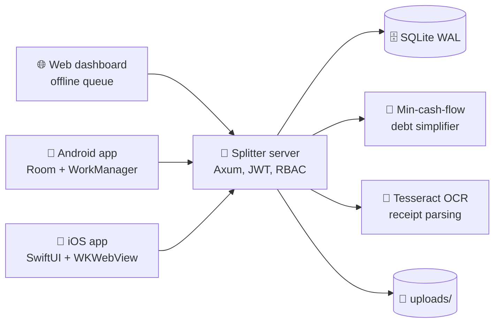
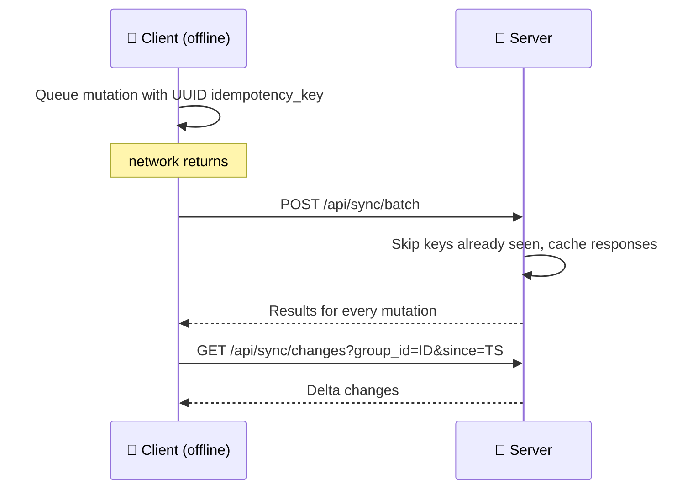

# 💸 Splitter


A fast, lightweight, self-hosted **expense-splitting server** with a web dashboard and Android and iOS clients. Create groups, add expenses, and Splitter works out the fewest payments that settle everyone up. It works offline too: changes queue on the device and sync safely when you're back online. The whole server is one Rust binary with an embedded SQLite database, so there's nothing else to run.

---

## ✨ Features

| | Feature |
|---|---|
| ⚡ | **Light and fast.** Rust with Axum and Tokio, embedded SQLite in WAL mode with pooling and automatic migrations. Zero ops. |
| 🔐 | **Auth and roles.** Argon2id password hashing, JWT bearer tokens (30 days), and an admin account created from `.env` or by promoting the first user. |
| 👥 | **Groups.** Multiple groups, each with its own currency (USD, INR, EUR, GBP and more). Add members by their registered email. |
| 🧾 | **Expenses.** Equal split (with exact penny-remainder distribution) or exact amounts, plus category tags (Food, Transportation, Housing, Entertainment, General). |
| 🧮 | **Debt simplification.** Net balances plus a greedy min-cash-flow pass reduce a tangle of N-way debts to the fewest direct payments. One-click settle up. |
| 📸 | **Receipts and OCR.** Attach bills (up to 20 MB). Image receipts are read with Tesseract to suggest the total and the merchant. |
| 📜 | **Activity log** per group, so everyone sees who added or changed what. |
| 📴 | **Offline-first.** Clients tag every change with a UUID idempotency key and queue it. The server de-duplicates and caches responses, so retries never double-charge. |
| 🌐 | **Web dashboard.** A single-page app served at `/`, installable as a PWA, with a dark look, Space Mono accents, a server-URL picker for any self-hosted instance, and a browser offline queue. |
| 🛡️ | **Admin console.** Platform stats, promote or demote users, deactivate accounts, create users with temporary passwords (with a forced password change on first login), and switch public sign-up on or off. |
| 📱 | **Mobile clients.** Android (Room and WorkManager queue, with a dynamic server selector) in `android/`, and iOS (SwiftUI and WKWebView) in `ios/`. |

---

## 🗺️ How it fits together





---

## 🚀 Quickstart

You need **Rust 1.75 or newer** ([rustup](https://rustup.rs)). For receipt scanning, install [Tesseract](https://github.com/tesseract-ocr/tesseract) too (the `tesseract` command must be on the server's `PATH`).

```bash
git clone https://github.com/sahuishan01/splitter.git
cd splitter
cp .env.example .env     # set JWT_SECRET, ADMIN_EMAIL and ADMIN_PASSWORD
cargo run
```

The server starts at `http://127.0.0.1:8088`. Open it in a browser for the web app. Run the tests with `cargo test`.

### ⚙️ Configuration

| Variable | Purpose |
|---|---|
| `HOST`, `PORT` | Bind address (default `127.0.0.1:8088`) |
| `DATABASE_URL` | SQLite database location |
| `JWT_SECRET` | Secret used to sign tokens. Use a long random value. |
| `ADMIN_EMAIL`, `ADMIN_PASSWORD` | Bootstrap admin account |
| `DISABLE_SIGNUP` | Set to `true` to turn off public registration (can also be toggled in the admin console) |

---

## 📚 API reference

All routes are under `/api`. Everything except login, register and config needs `Authorization: Bearer <token>`.

| Area | Endpoints |
|---|---|
| 🔑 **Auth** | `POST /auth/register`, `POST /auth/login` (returns `{ token, user }`), `GET /auth/me`, `PATCH /auth/profile`, `POST /auth/change-password`, `POST /auth/set-initial-password`, `GET /auth/config` |
| 🛡️ **Admin** (admin only) | `GET`/`POST /admin/users`, `PATCH /admin/users/:id/role` (`{ is_admin }`), `PATCH /admin/users/:id/status` (`{ is_active }`), `POST /admin/users/:id/reset-password`, `GET /admin/stats`, `GET`/`PATCH /admin/settings` |
| 👥 **Groups** | `POST`/`GET /groups`, `GET /groups/:id`, `POST /groups/:id/members` (`{ email }`), `DELETE /groups/:id/members/:user_id` |
| 🧾 **Expenses** | `POST`/`GET /groups/:id/expenses` (equal or exact splits, optional `idempotency_key`), `DELETE /groups/:id/expenses/:expense_id`, `GET /groups/:id/activities` |
| ⚖️ **Balances and settlements** | `GET /groups/:id/balances` (raw balances plus simplified debts), `POST`/`GET /groups/:id/settlements` |
| 📎 **Attachments** | `POST /upload`, `GET /attachments/:id`, `GET /attachments/:id/info`, `POST /ocr/scan` |
| 🔄 **Sync** | `POST /sync/batch` (`{ mutations: [{ idempotency_key, action, group_id, payload }] }`), `GET /sync/changes?group_id=ID&since=TIMESTAMP` |

---

## 📱 Mobile apps

- **Android** (`android/`): Kotlin app with a local Room queue and a WorkManager worker that flushes pending changes when the network is available. Release builds are shrunk with R8. See [android/README.md](android/README.md) for the queue design.
- **iOS** (`ios/`): SwiftUI shell around the web app in a `WKWebView`, with a configurable server URL.
- **Releases:** pushing a `v*` tag runs the [Release Mobile Apps workflow](.github/workflows/release-mobile.yml), which builds the Android APK and AAB and the iOS app. See [docs/RELEASES.md](docs/RELEASES.md).

---

## 🗂️ Project layout

```
src/
├── main.rs, lib.rs      server setup and routes
├── auth/                Argon2id hashing and JWT
├── routes/              auth, admin, groups, expenses, attachments, sync
├── services/            settlement simplifier, OCR parsing, activity log
└── models.rs, db.rs, error.rs
migrations/              SQLite schema migrations
static/                  web dashboard (index.html, PWA manifest, icons)
android/, ios/           mobile clients
tests/api_tests.rs       API integration tests
docs/RELEASES.md         mobile release process
```
